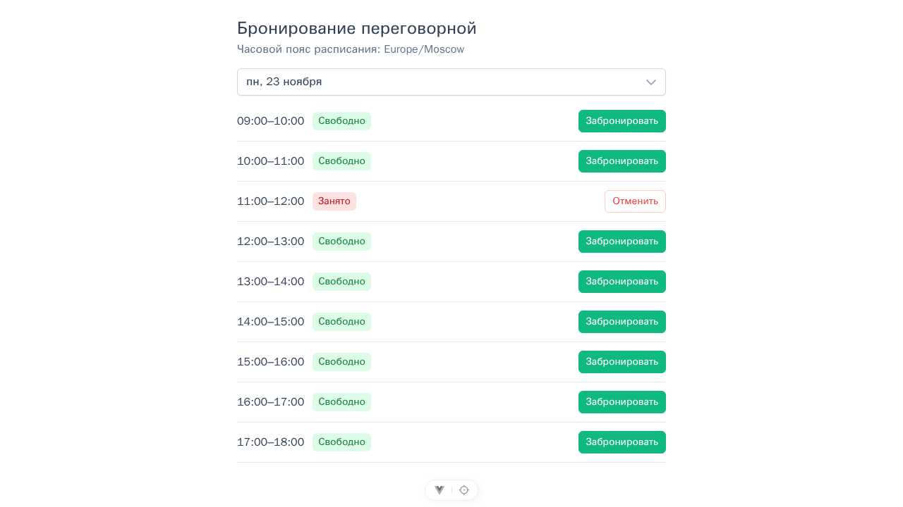
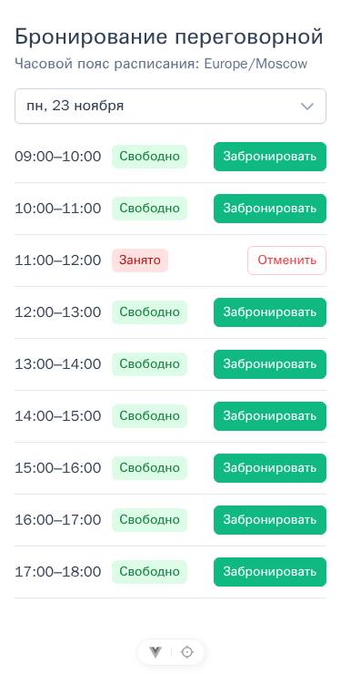

# Mini Booking — бронирование переговорной


Одна переговорная, часовые слоты 09:00–18:00 каждый день. Laravel (JSON API) + Vue 3 (одна страница на PrimeVue), PostgreSQL. Всё запускается в Docker одной командой.

| Ноутбук | Телефон, 375 px |
|---|---|
|  |  |

## Быстрый старт

```bash
make setup
```

Откройте `http://localhost:5173`. Документация API — `http://localhost:8000/docs/api`.

- `make setup` можно запускать повторно: он ничего не ломает и досоздаёт недостающие дни расписания.

## Где что посмотреть

| Критерий | Что сделано | Как проверить |
|---|---|---|
| API | `GET /api/slots`, `POST /api/bookings`, `DELETE /api/bookings/{id}`; JSON в том числе для ошибок; русские сообщения; OpenAPI | `http://localhost:8000/docs/api`, примеры curl ниже |
| Целостность данных | Частичный уникальный индекс «одна активная бронь на слот», вставка под транзакцией, `409` на конфликт; идемпотентный сидер; повтор с `Idempotency-Key` не создаёт вторую бронь | Команда гонки ниже: 10 одновременных запросов → один `201`; `make setup` дважды — слотов столько же |
| Интерфейс и асинхронные запросы | Загрузка и блокировка действий, ошибки полей на `422`, причина и перезагрузка на `409`, повтор при сбое сети, таймаут 10 с, защита от устаревших ответов, форма не закрывается во время запроса | `docker compose stop backend` и действия на странице; сценарий «потерянный ответ» ниже |
| Читаемость | Стандартный Laravel и Vue без своих слоёв; Pint, Larastan (уровень 5), ESLint, Prettier | `make check` |
| Тесты | Пирамида: Pest (32), Vitest (24), Playwright (E1 на ноутбуке и телефоне, E2); два теста из задания — ниже | `make check`, `make e2e` |
| Воспроизводимость | Только Docker; `make setup` от клона до работающего приложения; CI на каждый push поднимает проект со свежего клона и гоняет все проверки | Бейдж CI вверху |

**Два теста из задания** — в `backend/tests/Feature/BookingTest.php`:

- `books a free future slot` — бронь свободного будущего слота → `201` и id;
- `returns 409 for a repeated request on a booked slot and keeps one active booking` — повтор → `409`, активная бронь одна.

```bash
docker compose exec backend ./vendor/bin/pest --filter="books a free future slot|returns 409 for a repeated request"
```

### Примеры запросов

```bash
# расписание
curl -s localhost:8000/api/slots

# бронь (SLOT_ID — id свободного слота из расписания) → 201 {"data":{"id":…}}
curl -s -X POST localhost:8000/api/bookings -H 'Content-Type: application/json' \
  -d '{"slot_id":SLOT_ID,"customer_name":"Анна","customer_email":"anna@example.com"}'

# та же команда ещё раз → 409 {"message":"Этот слот уже занят."}

# неверные поля → 422 с ошибками по полям
curl -s -X POST localhost:8000/api/bookings -H 'Content-Type: application/json' -d '{"slot_id":"abc"}'

# отмена → 204; несуществующая бронь → 404 {"message":"Не найдено."}
curl -s -o /dev/null -w "%{http_code}\n" -X DELETE localhost:8000/api/bookings/BOOKING_ID
```

## Зависимости

- Docker с Compose v2 (`docker compose`; нужен флаг `--wait`) и `make`.
- macOS, Linux или Windows через WSL2.
- PHP, Node и PostgreSQL на машине не нужны — всё в контейнерах.

Версии внутри: PHP 8.4, Laravel 13, PostgreSQL 16, Node 24, Vue 3.5, PrimeVue 4.5 (тема Aura), Pest 4, Playwright 1.65.

## Настройки окружения

`backend/.env` создаётся из `backend/.env.example` при `make setup`.

| Переменная | По умолчанию | Что задаёт |
|---|---|---|
| `APP_TIMEZONE` | `Europe/Moscow` | Пояс расписания: в нём считается «сегодня», создаются слоты и показывается время |
| `BOOKING_DAYS` | `7` | На сколько дней вперёд (считая сегодня) создавать слоты |
| `BOOKING_OPEN_HOUR` / `BOOKING_CLOSE_HOUR` | `9` / `18` | Часы работы: первый слот 09:00–10:00, последний 17:00–18:00 |
| `BOOKING_RATE_LIMIT` | `30` | Сколько `POST`/`DELETE` броней в минуту можно с одного клиента |

- После правки `backend/.env` — `docker compose restart backend`: сервер читает `.env` только при старте.
- После правки расписания ещё `make fresh` (пересоздать базу и слоты).
- Порты на хосте — переменные `BACKEND_PORT` и `FRONTEND_PORT`.

## Команды

Все цели Makefile — короткие обёртки над `docker compose`.

| Цель | Что за ней стоит |
|---|---|
| `make setup` | `cp backend/.env.example backend/.env` (если нет) → `make up` → `migrate` → `db:seed` → `git config core.hooksPath .githooks` |
| `make up` / `make down` | `docker compose up -d --wait` (ждёт, пока сервисы станут здоровыми) / `docker compose down` |
| `make logs` | `docker compose logs -f backend frontend` |
| `make check` | сверка схемы API → `composer check` (Pint, Larastan, Pest) → `npm run check` (oxlint, ESLint, Prettier, vue-tsc, Vitest) |
| `make e2e` | `php artisan db:seed` → `docker compose run --rm e2e` (Playwright) |
| `make types` | TS-типы API из OpenAPI: `npx openapi-typescript http://backend:8000/docs/api.json -o src/api/schema.d.ts` |
| `make fix` | Pint, `eslint --fix`, Prettier |
| `make fresh` | `php artisan migrate:fresh --seed` — сброс базы |

Без `make` — те же команды вручную:

```bash
cp backend/.env.example backend/.env
docker compose up -d --wait                                  # обе части: backend на :8000, frontend на :5173
docker compose exec backend php artisan migrate              # миграции
docker compose exec backend php artisan db:seed              # расписание на 7 дней
docker compose exec backend composer check                   # тесты и проверки backend
docker compose exec frontend npm run check                   # тесты и проверки frontend
docker compose run --rm e2e                                  # e2e
```

Отдельно по частям: `docker compose up -d --wait backend` (поднимет и базу) и `docker compose up -d --wait frontend`.

Pre-commit хук (`.githooks/pre-commit`, включается в `make setup`) перед каждым коммитом запускает `make check`.

## Как обеспечена уникальность бронирования

- **Хранение.** `slots` — по строке на часовой слот, уникальное `starts_at`. `bookings` — брони; отмена = заполненное `cancelled_at`, строка не удаляется, история остаётся.
- **Гарантия в базе.** Частичный уникальный индекс:
  ```sql
  CREATE UNIQUE INDEX bookings_active_slot_unique ON bookings (slot_id) WHERE cancelled_at IS NULL;
  ```

  Отменённые брони в индекс не входят, поэтому слот после отмены снова можно занять.
- **Код не проверяет «занят ли слот» заранее** — такая проверка проигрывает гонку. Вставка идёт в транзакции; второй одновременный `INSERT` получает ошибку уникальности → `409 «Этот слот уже занят.»`.
- **Проверка гонки:** 10 одновременных запросов на один слот → один `201` и девять `409` (backend работает в 4 процесса, запросы действительно параллельны):
  ```bash
  seq 10 | xargs -P10 -I{} curl -s -o /dev/null -w "%{http_code}\n" -X POST localhost:8000/api/bookings \
    -H 'Content-Type: application/json' -d '{"slot_id":SLOT_ID,"customer_name":"Test","customer_email":"t@example.com"}'
  ```

  Лимит — 30 запросов в минуту с одного клиента. Для гонки на сотню запросов поднимите `BOOKING_RATE_LIMIT` и сделайте `docker compose restart backend`, иначе лишние запросы получат `429`.
- **Идемпотентность.** Форма шлёт заголовок `Idempotency-Key` (UUID, один на открытие формы). Если бронь создалась, а ответ потерялся, повтор с тем же ключом получит ту же бронь, а не `409` от собственной брони. Без ключа повтор — это новый запрос и получает `409`, как требует задание.

  Как увидеть в браузере: открыть форму и заполнить → `docker compose pause backend` → «Забронировать» → через 10 с ошибка → `docker compose unpause backend` (зависший запрос доходит до базы и создаёт бронь) → «Забронировать» ещё раз → «Слот забронирован». В DevTools → Network у обоих запросов один `Idempotency-Key`.

## Каким временем оперирует приложение

- Пояс расписания — `APP_TIMEZONE` из конфигурации Laravel (`Europe/Moscow`). В нём сидер считает «сегодня» и создаёт слоты 09:00–18:00.
- В базе — `timestamptz` (момент времени). Пояс сессии Postgres совпадает с поясом приложения, поэтому «09:00» сохраняется как 09:00 по Москве (06:00 UTC).
- «Сейчас» — время сервера. Слот прошедший, если его начало не позже текущего серверного времени (идущий слот тоже).
- API отдаёт время в ISO 8601 со смещением (`2026-11-23T09:00:00+03:00`) и название пояса в `meta.timezone`.
- Интерфейс показывает даты и время в поясе расписания, а не браузера (`Intl.DateTimeFormat` с `timeZone` из ответа API). Браузер в Нью-Йорке увидит те же «09:00–10:00».

## Тесты

| Уровень | Что проверяет |
|---|---|
| Pest (backend, настоящий Postgres) | Сидер: 63 слота, повторный запуск без дублей, запуск на следующий день, «сегодня» по Москве. `GET /api/slots`: порядок, статусы, формат, нет имени и email, закрытый CORS. Брони: `201`, `409` на занятый и прошедший слот, `422` по полям, отмена, `404`, `409` на отмену прошлого, rate limit по клиенту, идемпотентность |
| Vitest, юнит | HTTP-клиент (ошибки, сеть, таймаут, заголовки), формат времени в поясе расписания (тесты запущены в поясе Нью-Йорка), отбрасывание устаревших ответов, ключ идемпотентности |
| Vitest, компоненты | Форма брони (проверка полей, блокировка во время запроса, `201`/`409`/`422`/`429`/сбой сети, один ключ на все попытки), список слотов, отмена, страница (загрузка, ошибка и «Повторить», пустое расписание, фильтр дат) |
| Playwright | E1: бронь через интерфейс, когда первый ответ потерялся, и отмена — на ноутбуке и на телефоне 375 px. E2: одновременные запросы → ровно одна бронь |

## Допущения

- `GET /api/slots` отдаёт слоты с начала сегодняшнего дня: прошлые дни не засоряют фильтр. Сегодняшние утренние слоты показываются как прошедшие.
- Бронь прошедшего или идущего слота нельзя ни создать, ни отменить (`409`): прошлое не меняется. В интерфейсе такие слоты неактивны.
- Повторная отмена — `204`.
- Отменить бронь может любой, кто знает её id.
- Сокращение часов или дней в `.env` уже созданные слоты не удаляет — задание требует сохранять ранее созданные данные; полный сброс — `make fresh`.
- Статусы на открытой странице сами не обновляются. Решает сервер: устаревшая кнопка получит `409`, и список перезагрузится.
- Аудит зависимостей: `composer audit` — 0 уязвимостей. `npm audit` — 5 средней тяжести, все в инструментах тестов (`@vue/test-utils` → `js-beautify` → `glob`/`minimatch`), исправляются только откатом `@vue/test-utils` на версию с ломающими изменениями; в зависимостях самого приложения (`npm audit --omit=dev`) — 0.

## Что упрощено

- Dev-окружение: `artisan serve` и dev-сервер Vite вместо прод-сборки.
- Статусы на странице не обновляются сами (нет опроса или WebSocket) — актуальность гарантирует сервер.
